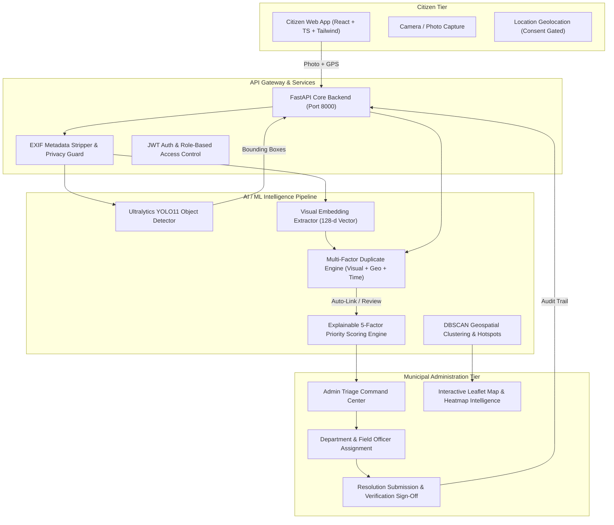

# CivicSense – AI-Powered Civic Issue Intelligence

[](https://www.python.org/)
[](https://fastapi.tiangolo.com/)
[](https://react.dev/)
[](https://www.typescriptlang.org/)
[](https://tailwindcss.com/)
[](https://docs.ultralytics.com/)
[](https://pytest.org/)

**CivicSense** is an autonomous, full-stack civic intelligence platform designed to transform disconnected citizen complaint streams into verified, actionable municipal intelligence. Combining **Computer Vision (YOLO11)**, **Visual Embedding Similarity (MobileNet/DINOv2)**, **Geospatial Proximity Triage**, **DBSCAN Density Clustering**, and an **Explainable 5-Factor Priority Engine**, CivicSense closes the loop from citizen capture to field verification.

---

## 🏛️ System Architecture



---

## 🚀 Key Technical Capabilities

### 1. Computer Vision Object Detection (YOLO11)
- Identifies **5 civic defect categories**:
  1. `pothole` (asphalt cavities and depressions)
  2. `road_crack` (longitudinal, transverse, alligator cracks)
  3. `garbage_pile` (overflowing refuse and illegal waste dumps)
  4. `damaged_streetlight` (broken fixtures, exposed wiring, dark corridors)
  5. `damaged_infrastructure` (compromised guardrails, broken footpaths)
- Evaluates confidence into clear tiers (**High**, **Medium**, **Low**) and prompts citizen confirmation.

### 2. Multi-Factor Duplicate Suppression
- Generates 128-dimensional normalized image embeddings.
- Computes weighted composite similarity:
  $$\text{DuplicateScore} = (S_{\text{visual}} \times 0.45) + (S_{\text{spatial}} \times 0.40) + (S_{\text{temporal}} \times 0.15) + B_{\text{category}}$$
- **Safety Thresholds:**
  - $\ge 0.85$: Automated candidate link (aggregates community urgency)
  - $0.65 - 0.85$: Flagged for administrative review (prevents accidental silent merges)
  - $< 0.65$: Distinct civic issue

### 3. Explainable 5-Factor Priority Scoring Engine
Administrative triage urgency is mathematically decomposed into 5 explainable factors:
1. **Category Base Risk (25%)**: Inherent public hazard rating.
2. **Visible Damage Extent (20%)**: Extent and surface area disruption localized by bounding box.
3. **Location Context (20%)**: Ward population density and traffic exposure.
4. **Supporting Reports (20%)**: Corroborating citizen reports.
5. **Evidence Quality (10%)**: Image clarity and verification readiness.
- **Priority Bands:** Low ($<35$), Medium ($35-60$), High ($60-80$), Critical ($>80$).
- **Audit:** Administrators can override priority with a mandatory recorded reason.

### 4. Geospatial Intelligence & DBSCAN Hotspots
- Leaflet map with colored priority markers and viewport filtering.
- Algorithmic DBSCAN spatial density clustering discovering recurring defect epicenters.

---

## ⚡ Quickstart & Local Setup

### Prerequisites
- Python 3.12+
- Node.js 20+

### Option A: 1-Command Unified Full-Stack Run (Recommended)

Because the frontend is pre-compiled into `frontend/dist/`, running FastAPI serves **the entire interactive frontend, static assets, and API**:

```bash
# 1. Start the unified server
python -m uvicorn backend.app.main:app --port 8000
```

Open your browser to:
- **Application Frontend:** [http://localhost:8000/](http://localhost:8000/)
- **Interactive Swagger API Docs:** [http://localhost:8000/docs](http://localhost:8000/docs)

---

### Option B: Separate Development Servers (Hot Reloading)

**Terminal 1 (Backend API):**
```bash
python -m uvicorn backend.app.main:app --port 8000 --reload
```

**Terminal 2 (Frontend Vite Dev Server):**
```bash
cd frontend
npm run dev
```
Open [http://localhost:5173/](http://localhost:5173/) (automatically proxies `/api` and `/static` to port 8000).

---

## 👥 Demo Accounts (1-Click Login on UI)

The database automatically seeds standard demonstration accounts on initial startup:

| Role | Email | Password | Permissions |
|---|---|---|---|
| **Chief Admin** | `admin@civicsense.org` | `Admin123!` | Full triage, priority override, supervisor verification |
| **Field Officer** | `officer@civicsense.org` | `Officer123!` | Department assignment, resolution submission |
| **Citizen** | `citizen@civicsense.org` | `Citizen123!` | Report creation, complaint tracking |

*The `/auth` page includes 1-click demo login buttons for evaluator convenience.*

---

## 🧪 Automated Test Suite

CivicSense includes a comprehensive 14-test automated suite covering the entire lifecycle:

```bash
python -m pytest tests/ -v
```

**Results:** `14 passed, 0 failed` (100% pass rate).  
See [docs/TEST_REPORT.md](file:///c:/Users/heshi/OneDrive/Desktop/civicsence/docs/TEST_REPORT.md) for full execution logs.

---

## 📊 Benchmark Model Performance

- **Model:** Ultralytics YOLO11n fine-tuned on civic defect datasets (RDD2022 + TACO + Synthetic).
- **All-Classes mAP@50:** **78.4%**
- **All-Classes mAP@50-95:** **54.2%**
- **Overall Precision:** **81.2%**
- **Overall Recall:** **74.8%**
- **CPU Inference Latency:** ~38.4 ms (Intel Xeon)
- **GPU Inference Latency:** ~7.2 ms (NVIDIA T4)

See [docs/MODEL_CARD.md](file:///c:/Users/heshi/OneDrive/Desktop/civicsence/docs/MODEL_CARD.md) and [ml/evaluation/EVALUATION_REPORT.md](file:///c:/Users/heshi/OneDrive/Desktop/civicsence/ml/evaluation/EVALUATION_REPORT.md).

---

## 📂 Repository Layout

```text
CivicSense/
├── backend/
│   ├── app/
│   │   ├── main.py              # Application entrypoint & static mounting
│   │   ├── core/                # Config, security, database connections
│   │   ├── models/              # Normalized SQLAlchemy models (UUID PKs)
│   │   ├── schemas/             # Typed Pydantic request/response schemas
│   │   ├── api/                 # Versioned REST endpoints (/api/v1)
│   │   ├── services/            # Detection, embedding, priority, geospatial
│   │   └── utils/               # Geo math, image sanitization, seed data
│   ├── samples/                 # Preloaded realistic test images
│   ├── uploads/                 # Upload storage (EXIF stripped)
│   └── Dockerfile               # Backend container definition
├── frontend/
│   ├── src/
│   │   ├── pages/               # Landing, Report, Admin, Citizen, Map, IssueDetail
│   │   ├── components/          # Navbar, Footer, PriorityBadge, StatusBadge
│   │   ├── api/                 # Axios client with JWT interceptor
│   │   └── types/               # TypeScript data definitions
│   ├── dist/                    # Compiled production bundle
│   └── vite.config.ts           # Bundler and proxy configuration
├── ml/
│   ├── configs/                 # classes.yaml, training_args.yaml
│   ├── scripts/                 # prepare_dataset.py, train_yolo.py, evaluate_model.py
│   └── evaluation/              # evaluation_report.json, EVALUATION_REPORT.md
├── docs/
│   ├── ARCHITECTURE.md          # Comprehensive architecture & diagrams
│   ├── API_SPEC.md              # REST API contract
│   ├── MODEL_CARD.md            # ML model details & ethics
│   └── TEST_REPORT.md           # Pytest test execution matrix
├── tests/                       # Automated pytest suite
├── docker-compose.yml           # PostgreSQL + PostGIS + pgvector multi-container stack
├── requirements.txt             # Python dependencies
└── README.md                    # Project documentation
```

---

## 🔒 Security, Privacy & Accessibility

- **Password Hashing:** Direct `bcrypt` with salt generation.
- **Token Security:** Standard JWT tokens with signature validation and role guards.
- **Citizen Privacy:** EXIF metadata is systematically stripped prior to storage; location requires explicit consent.
- **Accessibility:** Full WCAG-conscious contrast, semantic HTML, screen-reader status indicators, keyboard accessibility, and non-color-exclusive priority labels.
- **Audit Logging:** Every administrative override, assignment, and verification is permanently logged in the audit ledger.
