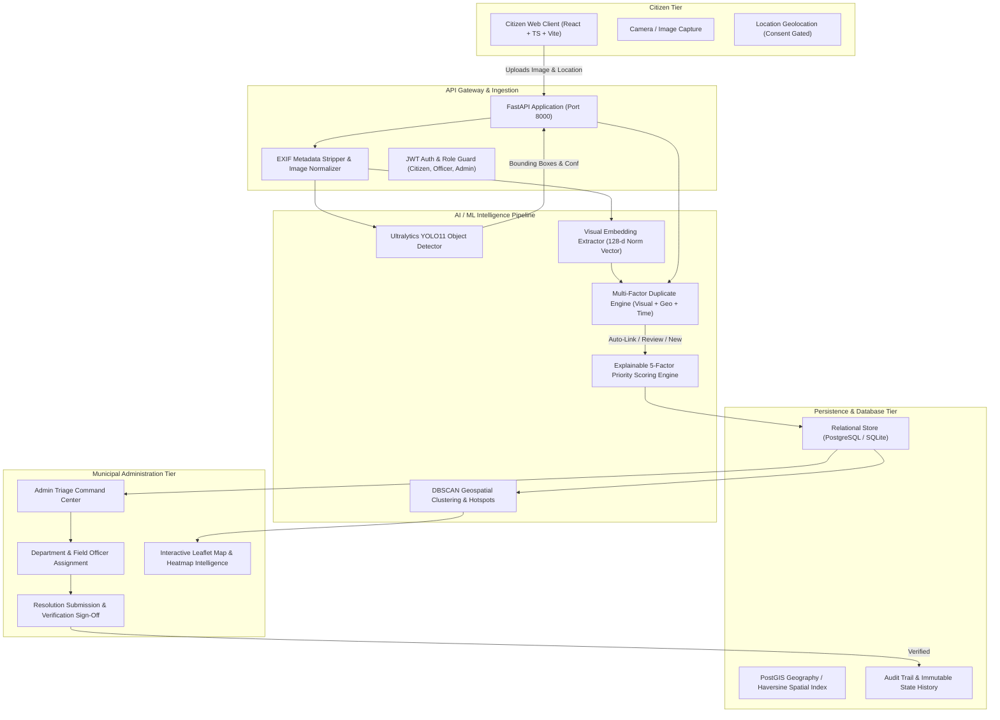

# CivicSense System Architecture

CivicSense is a production-grade, AI-powered civic issue intelligence and municipal dispatch platform designed to transform disconnected citizen complaint streams into verified, actionable municipal intelligence.

---

## 1. Core Architectural Subsystems

### A. Computer Vision Object Detection
- **Detector:** Ultralytics YOLO11 fine-tuned for civic infrastructure defects.
- **Taxonomy (5 Classes):**
  1. `pothole` (cavities and surface voids)
  2. `road_crack` (longitudinal, transverse, and fatigue alligator cracking)
  3. `garbage_pile` (overflowing refuse and illegal waste dumps)
  4. `damaged_streetlight` (broken fixtures, leaning poles, exposed fixtures)
  5. `damaged_infrastructure` (compromised pedestrian guardrails, sidewalks, open utility covers)
- **Confidence Handling:**
  - `High (>= 0.70)`: Automated category suggestion
  - `Medium (0.40 - 0.70)`: Citizen confirmation prompted
  - `Low (< 0.40)`: Manual categorization fallback

### B. Image Embedding & Spatial Duplicate Engine
1. **Visual Embedding:** Generates 128-dimensional L2-normalized feature vectors.
2. **Spatial Search:** Bounded candidate retrieval within configurable radius (default 150m).
3. **Multi-Factor Duplicate Scoring Formula:**
   $$\text{DuplicateScore} = (S_{\text{visual}} \times 0.45) + (S_{\text{spatial}} \times 0.40) + (S_{\text{temporal}} \times 0.15) + B_{\text{category}}$$
4. **Safety Action Bands:**
   - Score $\ge 0.85$: Candidate for automatic linking.
   - Score $0.65 - 0.85$: Manual administrative review (prevents silent false-positive merges).
   - Score $< 0.65$: Distinct civic issue.

### C. Explainable Priority Triage Engine
Rather than an uninterpretable black-box score, CivicSense estimates administrative urgency using a 5-factor weighted model:

| Factor | Weight | Evaluation Criteria |
|---|---:|---|
| **Category Base Risk** | 25% | Inherent hazard index (Infrastructure: 80, Pothole: 75, Streetlight: 70, Waste: 65, Crack: 45) |
| **Visible Damage Extent** | 20% | Normalized bounding box surface disruption and detection count |
| **Location Context** | 20% | Ward population density and traffic exposure (High/Critical vs Low) |
| **Supporting Reports** | 20% | Log-scaled volume of corroborating citizen complaints |
| **Evidence Quality** | 10% | Image resolution, clarity, and metadata consistency |

- **Bands:** Low ($<35$), Medium ($35-60$), High ($60-80$), Critical ($>80$).
- **Audit:** Administrators can override priority with a mandatory recorded reason.

### D. Geospatial Analytics & DBSCAN Hotspots
- Uses density-based spatial clustering (DBSCAN) with Haversine distance metric to identify recurrence clusters without requiring pre-defined neighborhood boundaries.
